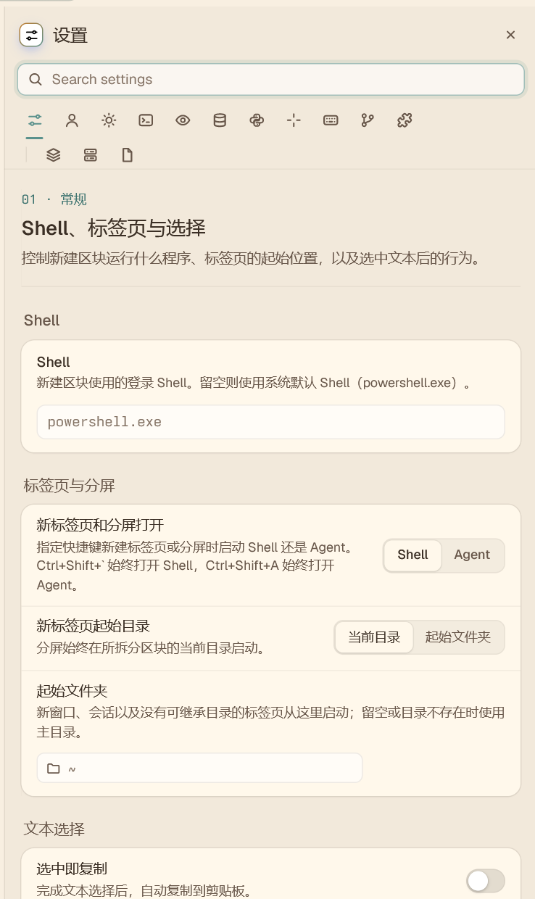
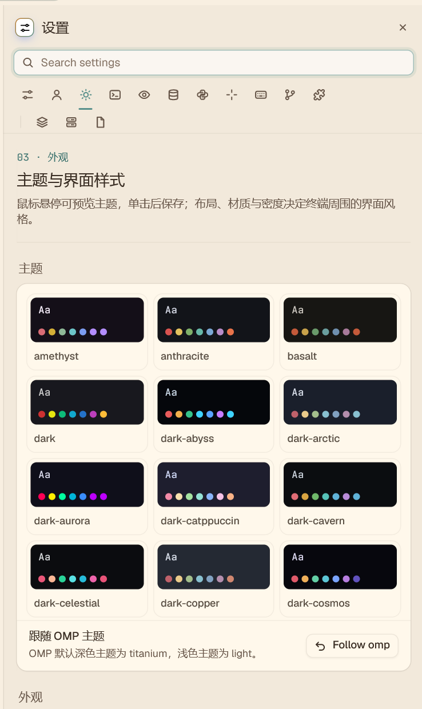
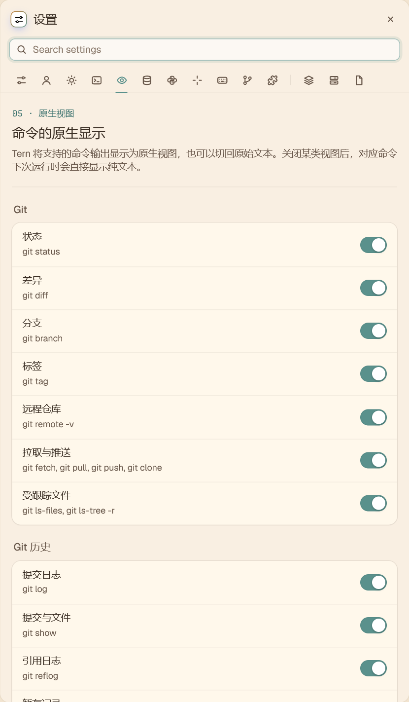
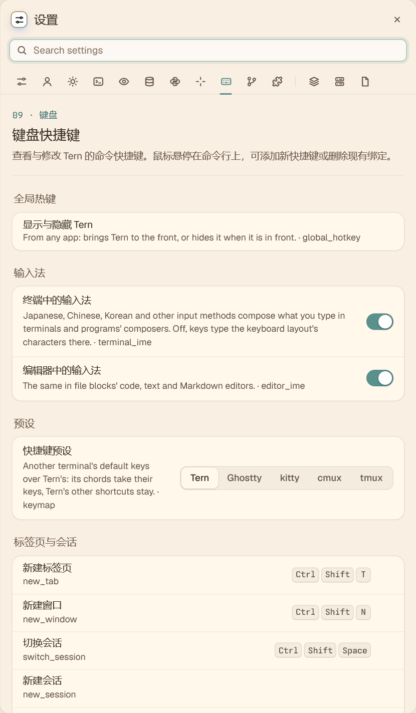
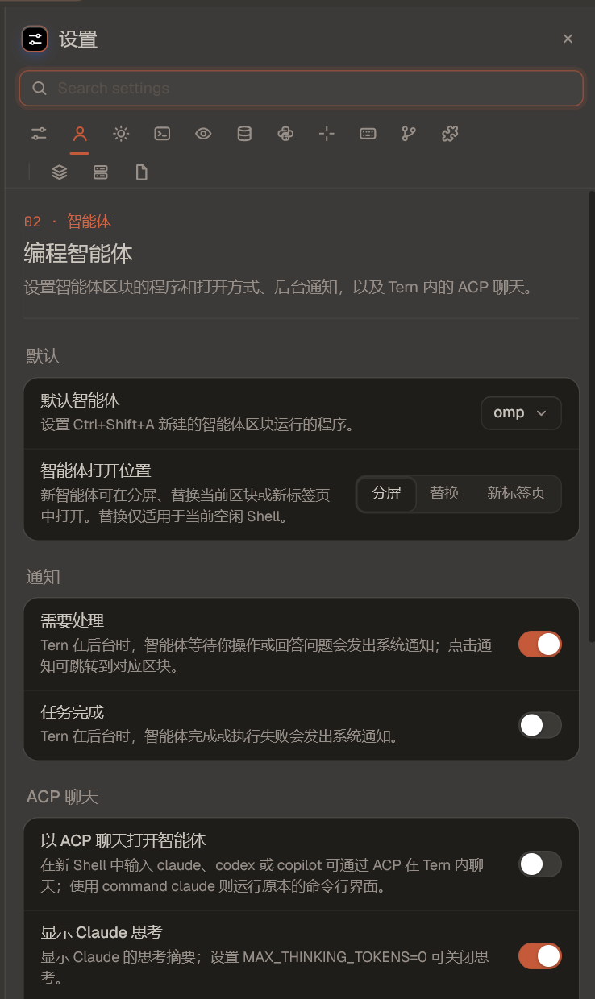
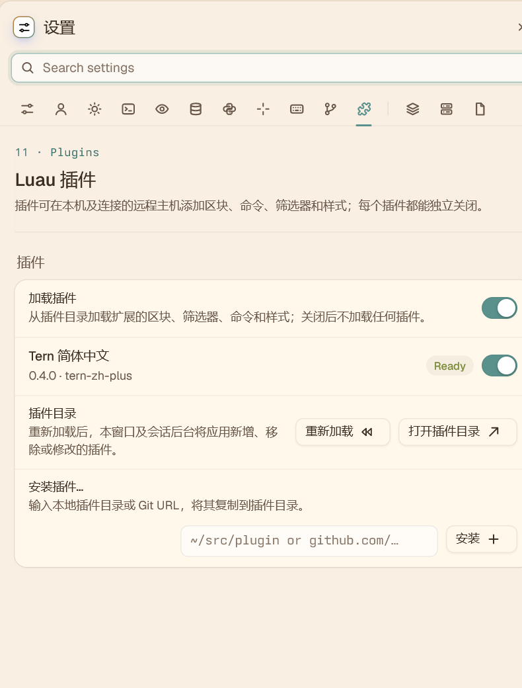
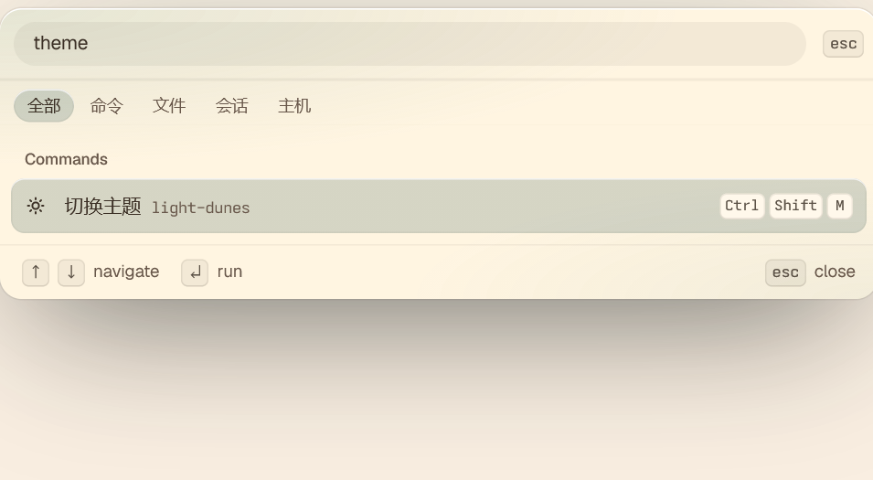
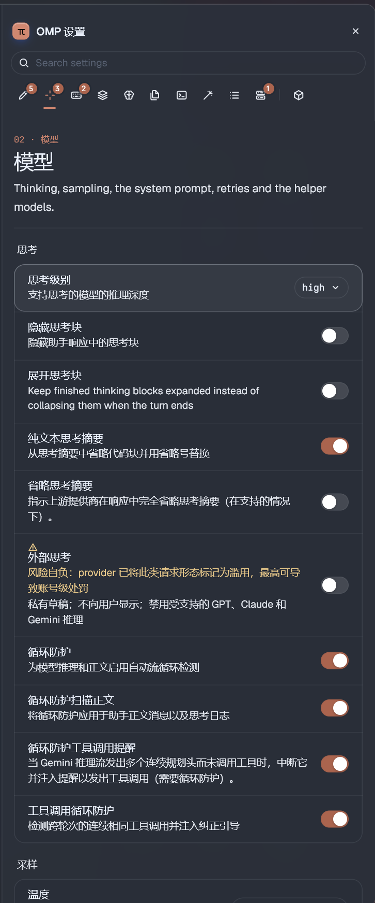
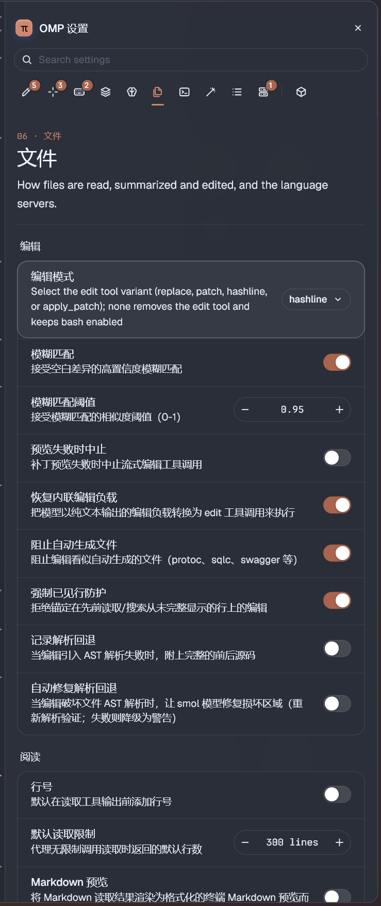

# Tern 简体中文 0.6.0（Windows）

## 截图

| 常规设置 | 外观设置 |
| :---: | :---: |
|  |  |
| 原生视图 | 快捷键 |
|  |  |
| 智能体 | 插件 |
|  |  |

命令面板：

OMP 原生设置页（需安装 [omp-di18n 汉化扩展](https://github.com/losewayy/omp-di18n)，部分说明仍为英文）：

| 模型设置 | 文件设置 |
| :---: | :---: |
|  |  |

## 安装与使用

首次安装：在 Tern 终端运行 `tern plugin install github.com/losewayy/tern-zh-cn`。

更新已安装的插件时，先关闭所有 Tern 窗口，再在其他终端运行 `tern plugin install github.com/losewayy/tern-zh-cn --force`。Windows 可能在 Tern 窗口打开时占用插件目录，因此更新前需要关掉窗口。

安装并启用后，直接使用 Tern 即可。从桌面、开始菜单、文件夹右键或其他入口打开，插件都会自动启动对应窗口的汉化小程序；关闭该窗口后，小程序会自动退出，不会随 Windows 开机启动。旧版中文快捷方式仍可使用，但不是必需的。

目前针对 Windows 上的 Tern 0.9.9 (9c1c09f) 和 0.9.12 (e498b49) 提供设置页汉化。其他版本仍会加载基础界面和中文命令，设置页会保留英文并提示兼容性，避免位置变化造成错译。OMP 设置页需要单独安装 [omp-di18n 汉化扩展](https://github.com/losewayy/omp-di18n)。

## 汉化范围

覆盖 Tern 基础界面、命令面板和 14 个设置分类的标题、说明与主要控件，以及终端区块常见右键菜单。尚未识别的菜单和新增内容保留原文。

设置页依靠页面位置应用样式；搜索设置时，为避免把页面翻译套到搜索结果上，结果会暂时显示原文。翻译属于界面显示层，不修改 Tern 程序、配置值或命令功能。

## 卸载

关闭所有 Tern 窗口后，在其他终端运行 `tern plugin remove tern-zh-plus`。小程序会随对应窗口退出。如需一并清除本地缓存，可删除 `%LOCALAPPDATA%/Tern/plugin-data/tern-zh-plus` 文件夹。

## 开发与兼容性

`window.luau` 和 `auto-bridge.luau` 负责窗口内的样式；`auto-bridge.cs` 是随窗口启动和退出的小程序源码；`prefs-*.css` 保存设置页翻译，`compat/0.9.9` 保存旧版差异页面，`ui-labels.tsv` 保存命令名称翻译。旧启动脚本仅供已创建的快捷方式兼容使用。

`tools/check_tern_settings.py` 与设置页基准用于开发时检查新版页面变化。确认兼容并更新翻译后，再为新版本启用设置页样式。隐私说明见 [PRIVACY.md](PRIVACY.md)，本项目采用 [MIT 许可证](LICENSE)。
