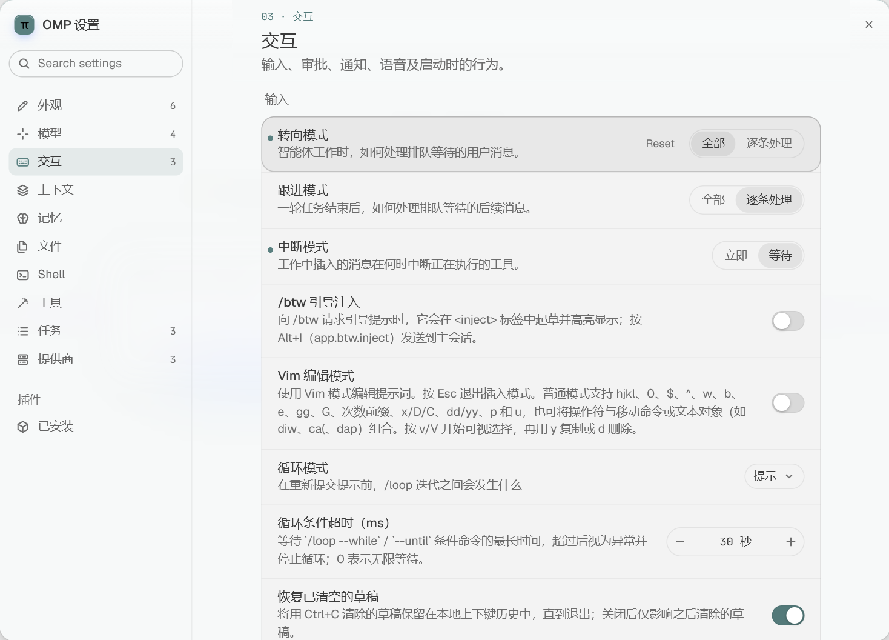

# Tern 简体中文 0.7.3

适用于 Windows 的非官方 Tern 汉化插件。安装后随 Tern 启动，覆盖设置、命令面板和常用菜单。

[更新记录](CHANGELOG.md) · [历史发行](https://github.com/losewayy/tern-zh-cn/releases) · [隐私说明](PRIVACY.md) · [MIT 许可证](LICENSE)

## 安装

需要[受支持的 Tern](#兼容性) 和 [Git](https://git-scm.com/install/windows)。在线安装需要能访问 GitHub，无需登录。

**方法一，终端。** 在 Tern 的终端里运行以下命令，安装完成后重新打开 Tern。

```powershell
tern plugin install github.com/losewayy/tern-zh-cn
```

**方法二，图形界面。** 打开 Tern 设置 → **Plugins** → **Install…**，输入 `github.com/losewayy/tern-zh-cn`，安装后重新打开 Tern。

## 更新和卸载

保存工作并关闭所有 Tern 窗口，然后在 PowerShell 或 Windows 终端中运行对应命令。

| 操作 | 命令 |
| --- | --- |
| 更新 | `tern plugin install github.com/losewayy/tern-zh-cn --force` |
| 卸载 | `tern plugin remove tern-zh-plus` |

安装和更新都获取 GitHub 主分支的当前版本。

## 兼容性

推荐 **Tern 0.9.36 (7123a24)**。也支持 **0.9.30 (fe54a4c)**、**0.9.23 (35c63ab)**、**0.9.12 (e498b49)** 和 **0.9.9 (9c1c09f)**。请核对版本号和括号内的构建编号。

插件翻译 14 个设置分类的标题、说明和常见选项。程序名、主题名和配置键保留原文，设置搜索和部分动态文字仍显示英文。其他 Tern 构建只启用基础界面和命令汉化。

## 截图

| Tern 常规设置 | Tern 外观设置 |
| :---: | :---: |
|  |  |

上面两张 Tern 截图来自 0.9.36。

### OMP 原生设置

下图实拍于 **Tern 0.9.36 + OMP 19.2.1**。在 OMP 里运行 `/settings` 会打开这个窗口。它在 Tern 里显示，管理的是 OMP 自己的设置，汉化需另装 [omp-di18n](https://github.com/losewayy/omp-di18n)。



## 常见问题

- **找不到 `tern`**：重新打开终端后再试，或用安装目录中的 `tern.com` 完整路径运行命令，例如 `& "<Tern 安装目录>/tern.com" plugin install github.com/losewayy/tern-zh-cn`。
- **安装失败**：确认 Git 已安装且可以访问 GitHub。若提示插件已存在，使用更新命令。
- **设置还是英文**：重新打开 Tern，检查设置 → **Plugins** 中插件是否启用，再核对上面的构建编号。

## 维护

新版固定设置文字由 `compat/` 中的样式按选中的分类显示。动态状态、命令面板和部分菜单由随窗口运行的本地小程序处理。译文只用于界面显示。

可用 `python tools/check_tern_settings.py --exe "<Tern 安装目录>/tern.com"` 对照 0.9.23 的设置布局基准。适配新构建时，还要在实际窗口检查页面切换和动态控件。
