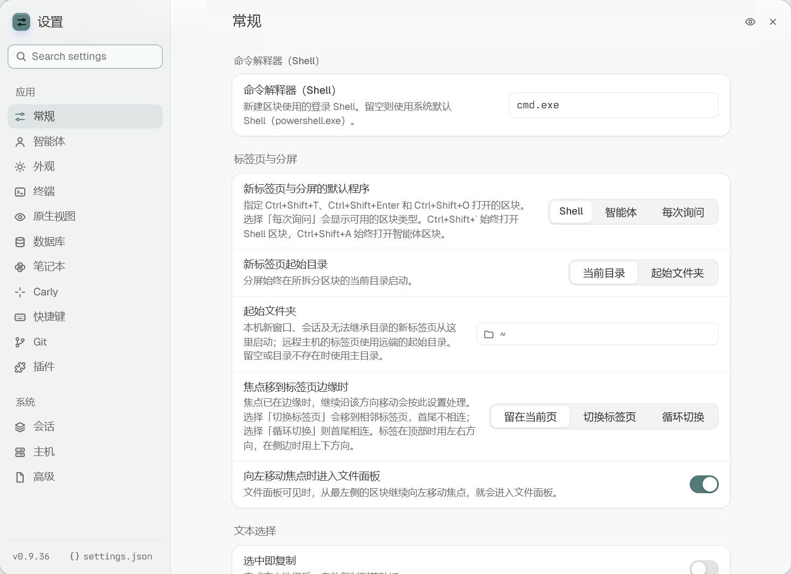
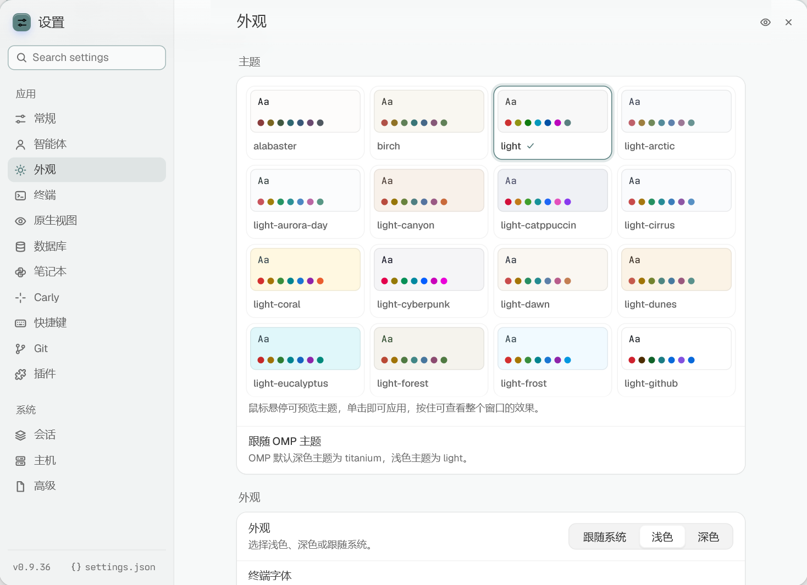
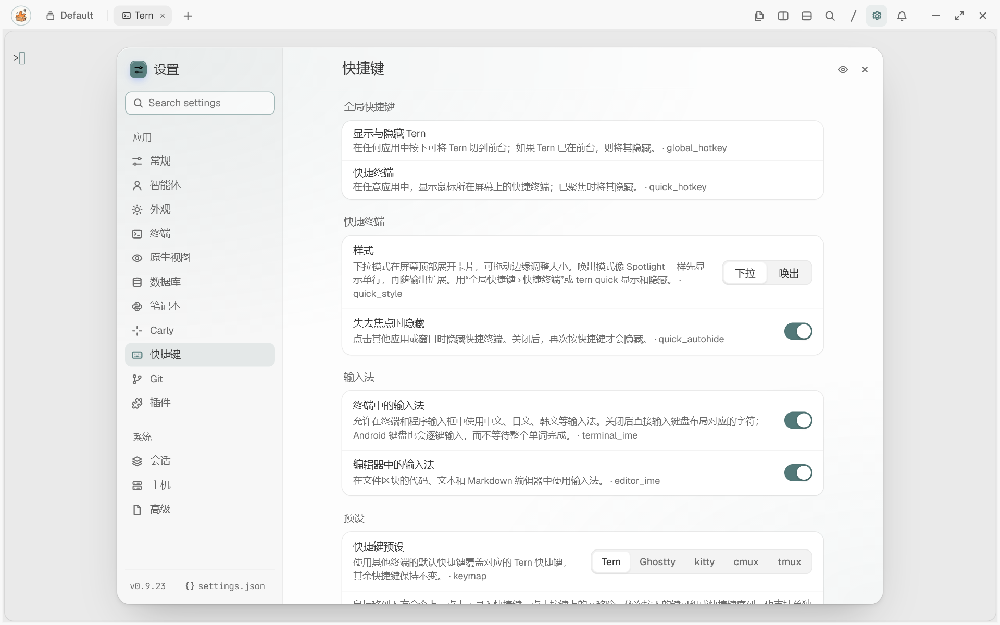
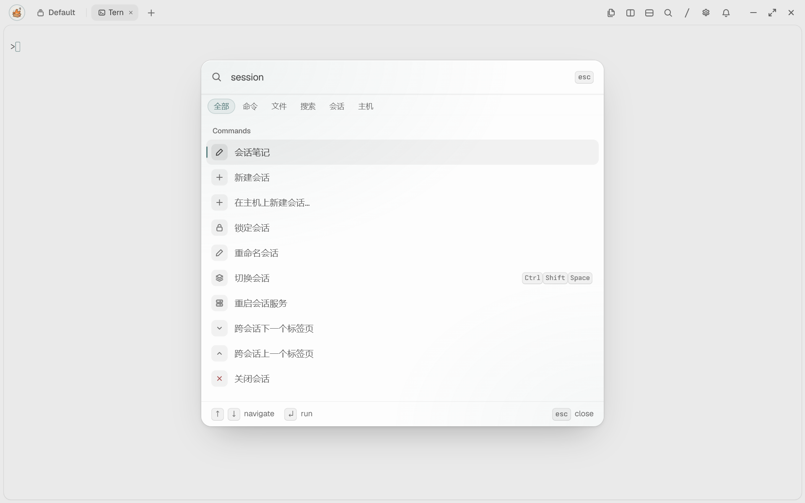
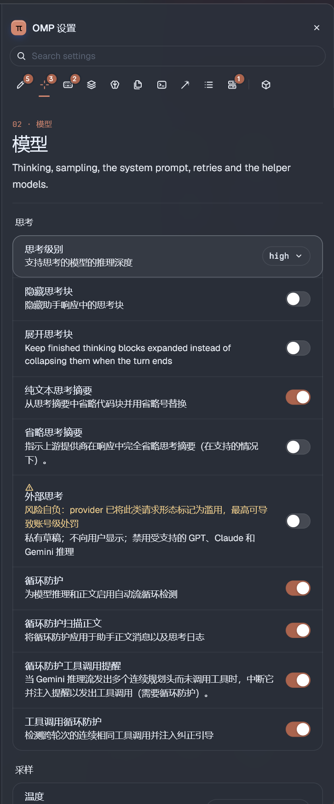
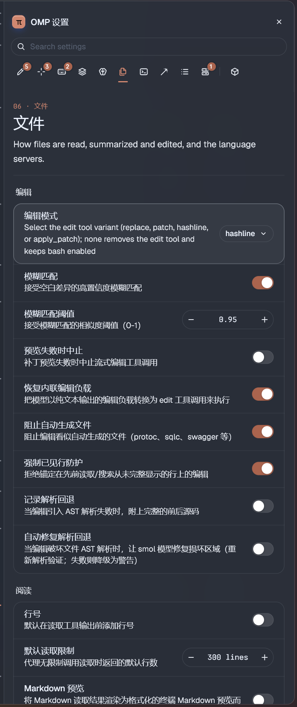

# Tern 简体中文 0.7.1（Windows，适配 Tern 0.9.23）

## 截图

以下设置截图使用 Tern 0.9.23 的新版弹窗布局。OMP 截图展示独立的 omp-di18n 扩展。

| 常规设置 | 外观设置 |
| :---: | :---: |
|  |  |
| 原生视图 | 快捷键 |
|  |  |
| 智能体 | 终端 |
|  |  |

命令面板：

OMP 原生设置页（需安装 [omp-di18n 汉化扩展](https://github.com/losewayy/omp-di18n)，部分说明仍为英文）：

| 模型设置 | 文件设置 |
| :---: | :---: |
|  |  |

## 安装与使用

首次安装：在 Tern 终端运行 `tern plugin install github.com/losewayy/tern-zh-cn`。

更新已安装的插件时，先关闭所有 Tern 窗口，再在其他终端运行 `tern plugin install github.com/losewayy/tern-zh-cn --force`。Windows 可能在 Tern 窗口打开时占用插件目录，因此更新前需要关掉窗口。

安装并启用后，直接使用 Tern 即可。从桌面、开始菜单、文件夹右键或其他入口打开，插件都会自动启动对应窗口的汉化小程序；关闭该窗口后，小程序会自动退出，不会随 Windows 开机启动。旧版中文快捷方式仍可使用，但不是必需的。

首次运行会在本机准备小程序，之后会复用已准备的文件以加快启动；文件留在本机时不会自行运行。

目前针对 Windows 上的 Tern 0.9.23 (35c63ab)、0.9.12 (e498b49) 和 0.9.9 (9c1c09f) 提供设置页汉化。0.9.23 使用新版弹窗和左侧分类列表，固定文字和常见选项随选中的分类直接切换。其他构建仍会加载基础界面和中文命令，设置页保留英文并提示兼容性。OMP 设置页需要单独安装 [omp-di18n 汉化扩展](https://github.com/losewayy/omp-di18n)。

## 汉化范围

覆盖 Tern 基础界面、命令面板、14 个设置分类的标题和说明、常见选项与操作按钮，以及终端区块常见右键菜单。新版智能体设置、终端提示符组件说明、快捷终端、底部组件、ovnfs 和 ABKit 设置也已补充。数据库的默认位置、换行方式和标识符引号会跟随实际设置值显示中文；默认位置的下拉菜单也支持中文。程序名、主题名、命令、配置键和版本号保留原文。搜索框占位文字、部分动态状态、任务操作及尚未适配的菜单仍为英文。

新版设置页按界面当前选中的分类限定样式，不等待后台判断页名；后台暂未更新或停止时，固定文字仍能正确切换。页内标签仍按该版本的布局定位。搜索时没有选中分类，页面翻译会自动停用，结果暂时显示原文。旧版设置页继续使用后台识别。选项按钮用透明 SVG 显示中文，继续使用原按钮的点击、键盘、焦点和选中状态，不更改配置值。翻译属于界面显示层，不修改 Tern 程序或命令功能。

新版分类、固定设置文字和常见选项直接由界面样式翻译。动态安装状态、命令面板和菜单仍使用随窗口运行的本地小程序；数据库选项值读取 Tern 自身的设置。Tern 0.9.23 尚未提供完整的内置界面语言接口。

## 卸载

关闭所有 Tern 窗口后，在其他终端运行 `tern plugin remove tern-zh-plus`。小程序会随对应窗口退出。如需一并清除本地缓存，可删除 `%LOCALAPPDATA%/Tern/plugin-data/tern-zh-plus` 文件夹。

## 开发与兼容性

`window.luau` 和 `auto-bridge.luau` 负责窗口内的样式；`auto-bridge.cs` 是随窗口启动和退出的小程序源码；`settings-navigation.css` 翻译新版左侧分类；根目录的 `prefs-*.css` 保存 0.9.12 设置页翻译，`compat/0.9.9` 保存旧版差异页面，`compat/0.9.23` 保存新版设置页翻译；`ui-labels.tsv` 保存命令名称翻译；`settings-controls.luau`、`settings-controls.tsv` 和 `settings-labels.tsv` 负责新版按钮、选项值及按当前分类限定的样式。旧启动脚本仅供已创建的快捷方式兼容使用。

运行 `python tools/check_tern_settings.py --exe "<Tern 安装目录>/tern.com"`，可在无界面实例中对照 0.9.23 的 14 个设置分类。检查旧版时，用 `--baseline tools/tern-0.9.12-settings.json` 指定旧基准。此检查覆盖标题、分组、标签及说明，不代表全部动态控件均兼容。确认原文、布局和实际显示后，再为新构建启用设置页样式。隐私说明见 [PRIVACY.md](PRIVACY.md)，本项目采用 [MIT 许可证](LICENSE)。
