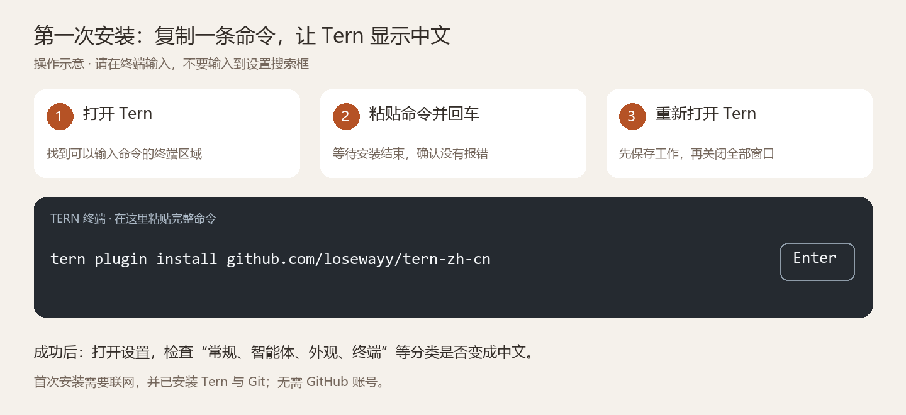
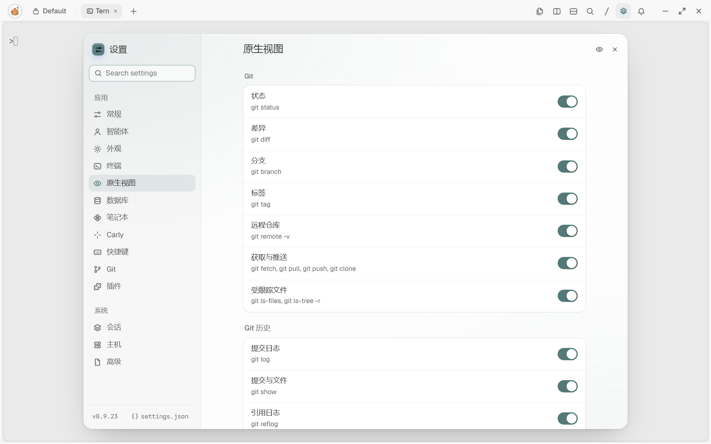
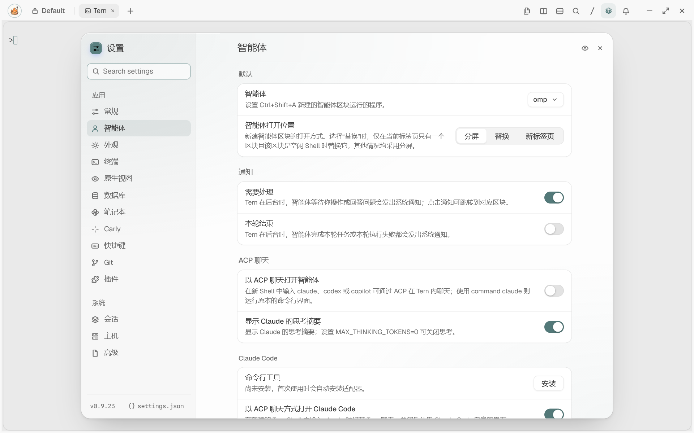
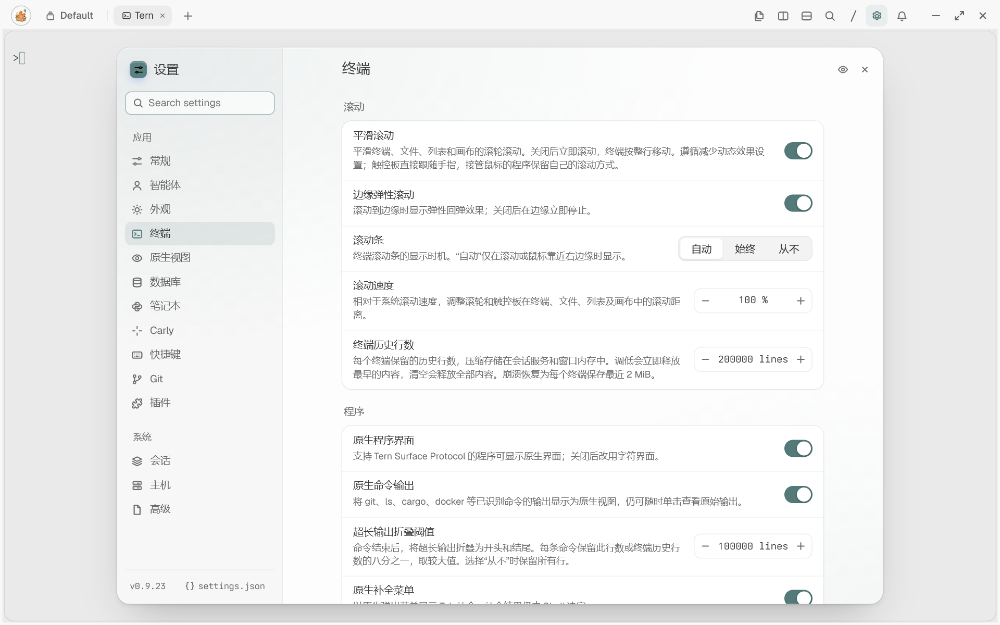

# Tern 简体中文 0.8.0（Windows，适配 Tern 0.9.35）

适用于 Windows 的非官方 Tern 汉化插件，安装后随 Tern 自动加载，无需单独打开启动脚本。本项目不包含 Tern 主程序，也不是 Tern 官方发行版。

[查看发行版本](https://github.com/losewayy/tern-zh-cn/releases/latest) · [查看更新记录](CHANGELOG.md) · [隐私说明](PRIVACY.md)

## 第一次使用

**不需要注册 GitHub 账号，也不用下载源码 ZIP。** 已经安装 Tern 的用户，按下面三步操作即可。

准备：使用 Windows，并安装受支持的 Tern。当前推荐 Tern **0.9.35 (ccfae03)**，也兼容 **0.9.30 (fe54a4c)**、**0.9.23 (35c63ab)**、**0.9.12 (e498b49)** 和 **0.9.9 (9c1c09f)**。版本号相同但构建编号不同，也可能无法启用设置页汉化。在线安装还需要 Git；如果电脑没有安装，请先从 [Git 官方 Windows 下载页](https://git-scm.com/install/windows) 安装 Git，装好后重新打开 Tern。

1. 打开 Tern，找到能输入命令的终端区域。不要在设置搜索框里输入。
2. 点击下面代码块右上角的复制按钮，粘贴到终端，按 **Enter（回车）**，等待安装命令结束。

   ```text
   tern plugin install github.com/losewayy/tern-zh-cn
   ```

3. 确认安装成功后，保存正在进行的工作，关闭所有 Tern 窗口，再重新打开 Tern。打开设置，检查左侧是否显示“常规、智能体、外观、终端”等中文分类。



图中是操作示意，不是安装成功的实际输出。安装过程中需要联网。安装完成后，日常汉化在本机运行，无需在线翻译。

**方法二，图形界面安装：** 在 Tern 设置的 **Plugins** 页面，将 `github.com/losewayy/tern-zh-cn` 粘贴到 **Install…** 的输入框，点击 **Install**，安装成功后重新打开 Tern。同样需要 Git 和网络。

## 更新已安装的插件

先保存工作并关闭所有 Tern 窗口，然后从 Windows 开始菜单打开 **PowerShell** 或 **Windows 终端**，粘贴下面的命令并按回车：

```text
tern plugin install github.com/losewayy/tern-zh-cn --force
```

命令成功结束后，重新打开 Tern。Windows 可能在 Tern 窗口打开时占用插件目录，因此请先关掉窗口再更新。

上述在线安装和更新命令获取仓库主分支的当前版本，不会锁定某次发行。发行页会记录每次发布对应的版本、适配范围和已知限制。

## 安装遇到问题

- **提示找不到 `tern`，或“无法将 tern 识别为命令”：** 先确认 Tern 主程序已安装，关闭并重新打开终端后重试。仍然找不到时，使用 Tern 安装目录中的 `tern.com` 的完整路径执行命令；PowerShell 中的写法是 `& "<Tern 安装目录>/tern.com" plugin install github.com/losewayy/tern-zh-cn`，请将占位内容换成实际目录。
- **提示找不到 Git：** 安装上面链接中的 Git，重新打开 Tern 后重试。
- **提示插件已经安装：** 按上面的“更新已安装的插件”操作，使用带 `--force` 的命令。
- **下载失败或连接超时：** 确认电脑能连接 GitHub，然后重新运行安装命令。下载失败不代表已经装好。
- **装好后设置仍是英文：** 先重新打开 Tern，再检查设置页的版本号及构建编号是否在支持范围内。未知构建会保留设置英文，避免把翻译套在错误位置。搜索结果和部分动态文字目前也会保留英文。

## 使用说明

安装并启用后，直接使用 Tern 即可。从桌面、开始菜单、文件夹右键或其他入口打开，插件都会自动启动对应窗口的汉化小程序；关闭该窗口后，小程序会自动退出，不会随 Windows 开机启动。旧版中文快捷方式仍可使用，但不是必需的。

首次运行会在本机准备小程序，之后会复用已准备的文件以加快启动；文件留在本机时不会自行运行。

目前针对 Windows 上的 Tern 0.9.35 (ccfae03)、0.9.30 (fe54a4c)、0.9.23 (35c63ab)、0.9.12 (e498b49) 和 0.9.9 (9c1c09f) 提供设置页汉化。0.9.23、0.9.30 和 0.9.35 使用新版弹窗和左侧分类列表，固定文字和常见选项随选中的分类直接切换。其他构建仍会加载基础界面和中文命令，设置页保留英文并提示兼容性。OMP 设置页需要单独安装 [omp-di18n 汉化扩展](https://github.com/losewayy/omp-di18n)。

## 截图

以下设置截图使用 Tern 0.9.23 的新版弹窗布局。OMP 截图展示独立的 omp-di18n 扩展。

| 常规设置 | 外观设置 |
| :---: | :---: |
|  |  |
| 原生视图 | 快捷键 |
|  |  |
| 智能体 | 终端 |
|  |  |

命令面板：


OMP 原生设置页（需安装 [omp-di18n 汉化扩展](https://github.com/losewayy/omp-di18n)，部分说明仍为英文）：

| 模型设置 | 文件设置 |
| :---: | :---: |
|  |  |

## 汉化范围

覆盖 Tern 基础界面、命令面板、14 个设置分类的标题和说明、常见选项与操作按钮，以及终端区块常见右键菜单。新版智能体设置、终端提示符组件说明、快捷终端、底部组件、ovnfs 和 ABKit 设置也已补充。数据库的默认位置、换行方式和标识符引号会跟随实际设置值显示中文；默认位置的下拉菜单也支持中文。程序名、主题名、命令、配置键和版本号保留原文。搜索框占位文字、部分动态状态、任务操作及尚未适配的菜单仍为英文。

新版设置页按界面当前选中的分类限定样式，不等待后台判断页名；后台暂未更新或停止时，固定文字仍能正确切换。页内标签仍按该版本的布局定位。搜索时没有选中分类，页面翻译会自动停用，结果暂时显示原文。旧版设置页继续使用后台识别。选项按钮用透明 SVG 显示中文，继续使用原按钮的点击、键盘、焦点和选中状态，不更改配置值。翻译属于界面显示层，不修改 Tern 程序或命令功能。

新版分类、固定设置文字和常见选项直接由界面样式翻译。动态安装状态、命令面板和菜单仍使用随窗口运行的本地小程序；数据库选项值读取 Tern 自身的设置。当前支持的 Tern 构建尚未提供完整的内置界面语言接口。

## 卸载

关闭所有 Tern 窗口后，在其他终端运行 `tern plugin remove tern-zh-plus`。小程序会随对应窗口退出。如需一并清除本地缓存，可删除 `%LOCALAPPDATA%/Tern/plugin-data/tern-zh-plus` 文件夹。

## 开发与兼容性

`window.luau` 和 `auto-bridge.luau` 负责窗口内的样式；`auto-bridge.cs` 是随窗口启动和退出的小程序源码；`settings-navigation.css` 翻译新版左侧分类；根目录的 `prefs-*.css` 保存 0.9.12 设置页翻译，`compat/0.9.9` 保存旧版差异页面，`compat/0.9.23` 保存新版设置页翻译，`layout-0930.luau` 和 `compat/0.9.30` 调整 0.9.30 变动的设置位置和译文，`compat/0.9.35` 保存 0.9.35 对齐后的完整样式和按钮表；`ui-labels.tsv` 保存命令名称翻译；`settings-controls.luau`、`settings-controls.tsv` 和 `settings-labels.tsv` 负责新版按钮、选项值及按当前分类限定的样式。旧启动脚本仅供已创建的快捷方式兼容使用。

运行 `python tools/check_tern_settings.py --exe "<Tern 安装目录>/tern.com"`，可在无界面实例中对照 0.9.23 的 14 个设置分类；检查其他构建时用 `--baseline tools/tern-0.9.35-settings.json` 这类基准文件指定目标版本，`--record-from-port` 可录制新基准。适配新构建时，按 [tools/port_settings.py](tools/port_settings.py) 的说明先用基线对齐 `compat/<版本>`，再在 `auto-bridge.luau` 和 `auto-bridge.cs` 中启用该版本。此检查覆盖标题、分组、标签及说明，不代表全部动态控件均兼容。确认原文、布局和实际显示后，再为新构建启用设置页样式。隐私说明见 [PRIVACY.md](PRIVACY.md)，本项目采用 [MIT 许可证](LICENSE)。
